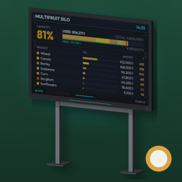
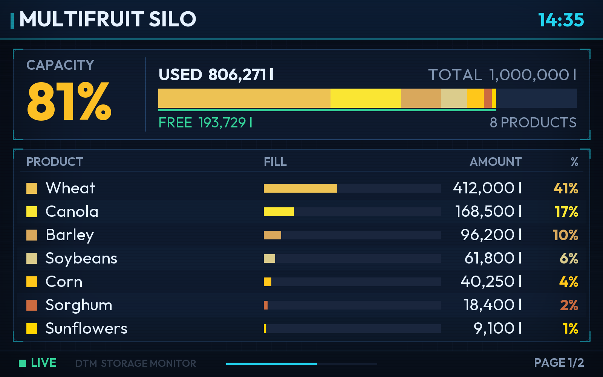
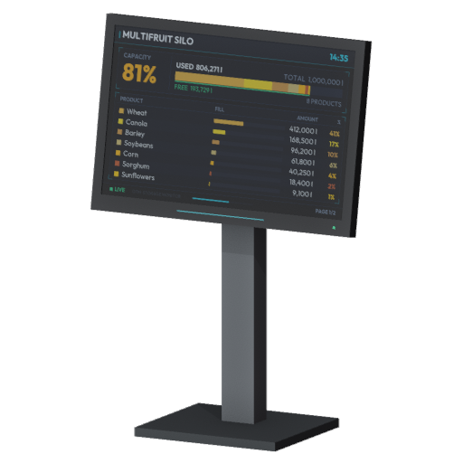
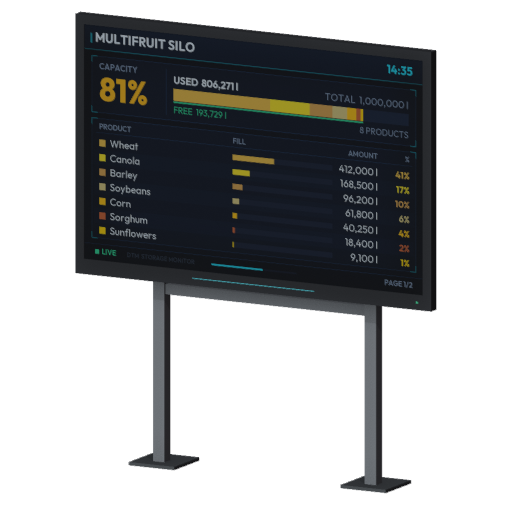

<p align="center">
  <a href="https://github.com/DTM-Mods"></a>
</p>

<p align="center">
  
</p>

<h1 align="center">Storage Monitor</h1>

<p align="center">
  
  
  <a href="https://github.com/DTM-Mods"></a>
</p>

<p align="center">
  <b>A live colour screen next to your silo: how full it is, what's in it and how much room is left, at a glance.</b>
</p>

<p align="center">
  
</p>

<p align="center">
  
</p>

Put a monitor next to a silo, production or animal storage and it shows that storage's contents, live:

- **How full:** the percent in big numbers, green, then amber from 75 % and red from 90 %.
- **Used, free and total capacity**, and one bar across the screen with every product in its own colour.
- **Every product** with its amount, a fill bar and its percent, 7 per page. The pages turn by themselves.
- **Productions:** which products go in (IN) and which come out (OUT).
- **Shared capacity done right:** silos that share one capacity across all products count it once, not once per
  product.
- **The in-game time** in the corner.
- **Three sizes** in the shop under Buildings > Tools:

| Size | Screen | Price | Read from |
|---|---|---|---|
| Kiosk | 1.2 m on a pedestal | 3,500 | 30 m |
| Wall | 2.4 m on two posts, to stand against a silo | 6,500 | 50 m |
| Billboard | 4 m on tall posts | 12,000 | 90 m, from the tractor |

<p align="center">
  
  
  
</p>

<p align="center">
  
</p>

1. Buy a monitor (Buildings > Tools) and place it near the storage you want to watch.
2. It picks the nearest storage within 250 m by itself: stations with storages, silo extensions, your farm's
   productions and animal feed.
3. Want another one? Stand in front of the screen and press the action key (**Switch storage**) to step to the next
   nearest. The choice is saved with the game.

<p align="center">
  
</p>

- The storage choice is synced: everyone on the server sees the same one, and it is saved with the game.
- In silos that keep one stock per farm, every player sees their own farm's stock.
- The screen is drawn by each player's game. A dedicated server draws nothing, so it costs the server nothing.

<p align="center">
  
</p>

Put `FS25_Monitor.zip` in `Documents/My Games/FarmingSimulator2025/mods`. In multiplayer, install it on the server and
on every player's game.

<p align="center">
  
</p>

- The screen only shows while you look at its front and are within its reading distance (see the table above).
- No storage within 250 m: the screen says "No storage nearby".

<p align="center">
  
</p>

How it works:

- **The screen:** the model carries a baked texture with the panels (`textures/monitor_screen_diffuse.dds`).
  Everything live is drawn on top of it each frame on the client: text with `renderText3D`, bars with
  `drawDebugTriangle`, both depth tested and only while the camera is in front of the screen and within its draw
  distance.
- **The storage:** the nearest one within 250 m. Silos with a shared capacity (`Storage.capacity`) count it once;
  other storages add up their per-product capacities.
- **Multiplayer:** `StorageMonitorOffsetEvent` sends the "Switch storage" choice; it is also saved in the savegame.

Everything is made from scripts:

```
python tools/make_textures.py                       screen texture (+ preview with sample data)
blender --background --factory-startup --python tools/build_model.py      models, i3d export, shop renders
python tools/make_icon.py                           mod icon (with the DTM pin) and modhub/icon_512.png
python tools/gen_placeables.py                      placeable XMLs from the i3d, shop images and icon to .dds
python tools/build_mod.py                           checks, tests, build/FS25_Monitor.zip
```

Needs Blender 5.2 with the GIANTS I3D exporter, GIANTS Editor 10.0.14 (`textureTool.exe`), Python with Pillow and
[lupa](https://pypi.org/project/lupa/). `python tests/run_tests.py` runs the Lua offline on Lua 5.1 stubs of the engine.
The PNG masters in `src/` stay out of the zip (`.modignore`).

<p align="center">
  
</p>

### 1.0.0.0

- First version: live storage screen in three sizes (Kiosk, Wall, Billboard), nearest storage within 250 m, Switch storage synced in multiplayer and saved, English, German and French.

<p align="center">
  
</p>

MIT, see [LICENSE.txt](LICENSE.txt).

---

<p align="center">
  <a href="https://github.com/DTM-Mods"></a><br>
  <sub>Part of <a href="https://github.com/DTM-Mods">DTM Mods</a> (Designed To Manage) by PropaineX & Fennell</sub>
</p>
