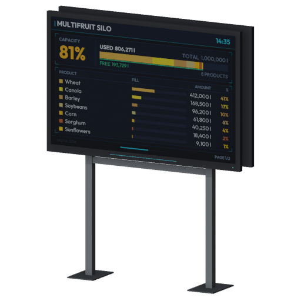
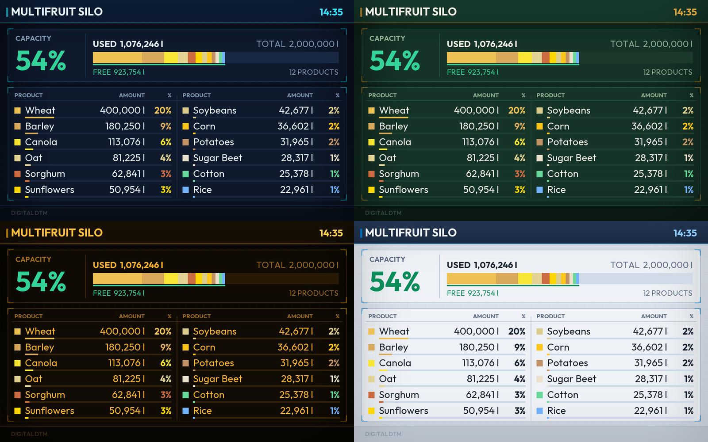
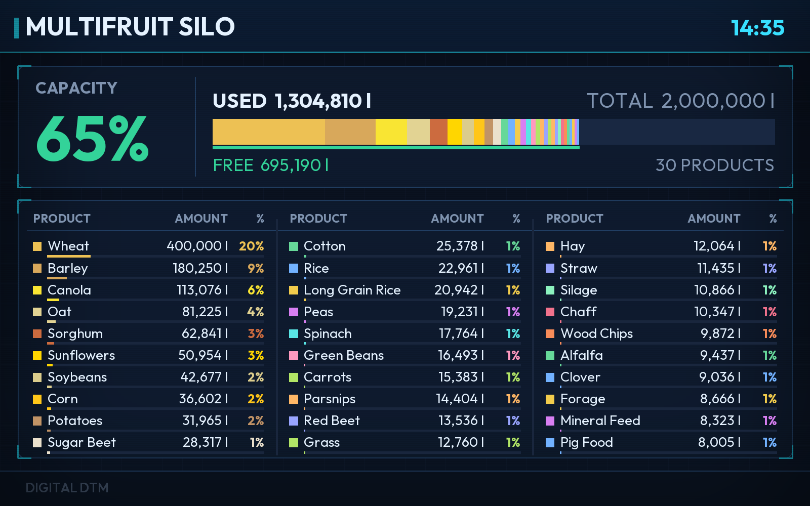

<p align="center">
  <a href="https://github.com/DTM-Mods"></a>
</p>

<p align="center">
  
</p>

<h1 align="center">Digital DTM</h1>

<p align="center">
  
  
  <a href="https://github.com/DTM-Mods"></a>
</p>

<p align="center">
  <b>A live colour screen next to your silo: how full it is, what's in it and how much room is left, at a glance.</b>
</p>

<p align="center">
  
</p>

<p align="center">
  
</p>

Put a monitor at a silo, production, animal pen, bunker silo, bale / pallet shed, manure heap, greenhouse or beehive and
it shows what is in it, live. It can also show your farm's money, or today's best prices:

- **How full:** the percent in big numbers, green, then amber from 75 % and red from 90 %.
- **Used, free and total capacity**, and one bar across the screen with every product in its own colour.
- **Every product at once** with its amount, a fill bar and its percent. The list adds columns (up to 3) and shrinks
  its text until everything fits, up to 42 products. Only beyond that it pages: by itself, or with Page Up / Page Down in
  front of the screen.
- **Real product icons:** every product with the game's own icon, in its colour.
- **Rates and time left:** how fast a storage fills or empties ("+18,000 l/h") and when it is full or empty; a rate
  per product; which input of a production runs out first; how long the animals' food lasts.
- **Price board:** switch a screen to prices: the best price for every product in the storage and where to sell it,
  whether the price rises or falls next month (the game's seasonal curve), and what the stock is worth. Pick "All silos
  of my farm" for a price board of the whole farm.
- **Alerts:** a blinking red stripe and a line in the footer when a silo or shed is nearly full, an input is empty, a
  greenhouse has no water, animals run low on food, water or straw, a tank is full, or the honey pallet spot is full.
  Optionally also as a game message for everyone on the farm (once per alert, not more than every 10 minutes).
- **Productions:** which lines run, which miss inputs or have a full output store; inputs (IN) and outputs (OUT),
  empty inputs in red.
- **Animal pens:** animals (e.g. 112/150), food, water, straw, productivity and the tanks, as the game's animal page.
- **Bunker silos:** filling, fermenting in percent, or ready; several bunkers side by side.
- **Bale and pallet sheds:** stored of capacity, and every product with its number of bales or pallets.
- **Manure heaps** and **greenhouses** (a greenhouse without water is flagged).
- **Beehives:** all of the farm's hives on one screen: how many, honey per day and what it is worth, whether the bees
  produce (not in winter), and the pallet spot.
- **All silos of my farm:** one screen with the whole farm's silo stock (pick it in the settings).
- **My farm's money:** balance, loan, credit left, and today's income and costs by category, biggest first.
- **Shared capacity done right:** silos that share one capacity across all products count it once, not once per
  product.
- **The in-game time** in the corner.
- **Pick the silo** from a list of everything nearby, or let it show the nearest.
- **Any size:** 0.8 to 6 m wide, on every model.
- **Readable at night:** the screen glows; five brightness levels.
- **Four colour themes:** night blue, DTM green, amber terminal and daylight.
- **Your own title** on the screen.
- **Seven models** in the shop under Buildings > Tools, free-standing, on a wall or hanging:

| Model | Screen | Price | Read from |
|---|---|---|---|
| Kiosk | 1.2 m on a pedestal | 3,500 | 30 m |
| Wall | 2.4 m on two posts | 6,500 | 50 m |
| Billboard | 4 m on tall posts | 12,000 | 90 m, from the tractor |
| Two-Sided Billboard | 4 m, a screen on each side | 18,000 | 90 m, from both sides |
| Silo Mount | 2.4 m on a bracket against the silo | 6,000 | 50 m |
| Wall Mount | 2.4 m flat against a building wall | 5,500 | 50 m |
| Hanging | 2.4 m on two rods, for inside a shed | 5,500 | 50 m |

The sizes are what you buy; every model can then be set from 0.8 to 6 m wide, and it is read from further away when
bigger.

<p align="center">
  
  
  
</p>

<p align="center">
  
  
  
</p>

<p align="center">
  
</p>

<p align="center">
  
</p>

<p align="center">
  
</p>

<p align="center">
  
</p>

<p align="center">
  
</p>

1. Buy a monitor (Buildings > Tools) and place it at the storage you want to watch. Silo mounts go right against the
   silo wall: the back of the bracket touches it.
2. It shows the nearest storage within 40 m by itself, each building on its own: a silo, each silo extension, your
   farm's productions, animal pens, bunker silos, bale / pallet sheds, manure heaps and beehives. "All silos of my
   farm" and "My farm's money" are at the end of the pick list.
3. Stand in front of the screen and press the activate key (**Monitor settings**):
   - **Pick the storage**: a list of every storage nearby, nearest first, or "Always the nearest". A picked silo stays
     picked when something nearer is built.
   - **Also show the silos connected to it**: a silo together with its extensions, as the game counts them when you
     load or unload.
   - **Screen size**: 0.8 to 6 m wide. The Silo Mount and Wall Mount keep their bottom edge 2 m above the ground
     (Hanging: 2.5 m) and grow upwards; the others grow from the ground, posts and all.
   - **Brightness**: very dim to very bright (screen glow, bars and text).
   - **Colours**: night blue, DTM green, amber terminal, daylight.
   - **Title**: type your own, or leave it empty for the storage's name.
   - **Screen shows**: the storage, or prices (the price board).
   - **Alerts**: off, on the screen, or on the screen and as a game message for your farm.
4. More than 42 products: **Page Up / Page Down** in front of the screen (rebindable under Controls). The pages stay
   where you put them for 30 seconds.

<p align="center">
  
</p>

- The settings (storage, connected silos, size, brightness, colours, title, prices, alerts) are synced: everyone on the server sees the same, and they are saved
  with the game. Paging is each player's own.
- In silos that keep one stock per farm, every player sees their own farm's stock.
- The screen is drawn by each player's game. A dedicated server draws nothing, so it costs the server nothing.
- Alert messages go to the players of the monitor's own farm only, from each player's own game.
- Rates need about a quarter of an in-game hour of readings before they show. A monitor nobody is near still reads its
  storage every 10 seconds, so rates and alerts keep going.

<p align="center">
  
</p>

Put `FS25_DigitalDTM.zip` in `Documents/My Games/FarmingSimulator2025/mods`. In multiplayer, install it on the server and
on every player's game.

<p align="center">
  
</p>

- The screen only shows while you look at its front and are within its reading distance (see the table above).
- No storage within 40 m: the screen says "No storage nearby".
- Every model has a collision for each screen size; the game switches on the one that fits, so a monitor can be
  selected (to sell it) at any size.

<p align="center">
  
</p>

How it works:

- **The screen:** the glass uses the game's `glowShader` (`staticLight`) with a baked panel texture per theme
  (`textures/screen_<theme>.dds`, swapped with `setMaterialDiffuseMapFromFile`); `lightControl` is the brightness.
  Text is drawn each frame with `renderText3D`. Bars are copies of a hidden 1 x 1 m glowing rectangle (`barTemplate`)
  placed, sized and coloured (`emitColor`) by the script; product icons are copies of `iconTemplate` with the fill type's
  HUD image as texture. The game does not draw `drawDebugTriangle` in normal play, and two bars at the same depth
  flicker, so bars never overlap.
- **The storage:** one entry per building (`spec_silo.storages`, `spec_siloExtension.storage`,
  `spec_husbandry.storage`, production storages, other mods' storages through their stations), the nearest within
  40 m or the picked one (remembered by the building's position). "Connected" adds every storage sharing a loading or
  unloading station. Silos with a shared capacity (`Storage.capacity`) count it once; other storages add up their
  per-product capacities.
- **The list:** `StorageMonitor.computeListLayout` picks 1 to 3 columns and the text size so everything fits.
  `python tools/render_screen.py` runs the real Lua and paints what it draws into `src/screens/`.
- **Settings:** the game's `OptionDialog`; `StorageMonitorSettingsEvent` syncs them; they are saved in the savegame.
- **Rates:** a sample of the levels every 5 in-game minutes, kept for 2 in-game hours; the rate is the change over
  that time. Animal food uses the pen's own `litersPerHour` when it has one.
- **Prices:** the unloading stations that sell (`isSellingPoint`, not the farm's own productions or animal pens),
  `getEffectiveFillTypePrice`, read at most every 10 seconds for all monitors; the trend is the fill type's
  `economy.factors` from this month to the next.
- **Performance:** a monitor out of sight reads its storage every 10 seconds (every 2.5 seconds beyond half its reading
  distance, every second up close); screens behind the camera are not drawn, and at most 8 monitors are drawn, nearest
  first. Fitted texts are measured once per reading, not every frame.

Everything is made from scripts:

```
python tools/make_textures.py                       screen texture (+ preview with sample data)
blender --background --factory-startup --python tools/build_model.py      models, i3d export, shop renders
python tools/make_icon.py                           mod icon (with the DTM pin) and modhub/icon_512.png
python tools/gen_placeables.py                      placeable XMLs from the i3d, shop images and icon to .dds
python tools/build_mod.py                           checks, tests, build/FS25_DigitalDTM.zip
```

Needs Blender 5.2 with the GIANTS I3D exporter, GIANTS Editor 10.0.14 (`textureTool.exe`), Python with Pillow and
[lupa](https://pypi.org/project/lupa/). `python tests/run_tests.py` runs the Lua offline on Lua 5.1 stubs of the engine.
The PNG masters in `src/` stay out of the zip (`.modignore`).

<p align="center">
  
</p>

### 1.2.0.0

- Price board: the best price for every product and where to sell it, the trend to next month and the value of the
  stock (setting "Screen shows: Prices").
- Rates and time left: "+18,000 l/h", full / empty in, a rate per product, which production input runs out first, how
  long the animals' food lasts.
- Alerts on the screen (blinking stripe, footer line) and optionally as a game message for the farm.
- New kinds: manure heaps, greenhouses (no water flagged), beehives (all of the farm's hives on one screen), and the
  farm's money (balance, loan, credit, today's income and costs).
- Three new models: Two-Sided Billboard, Wall Mount (flat on a building) and Hanging (on rods, for inside a shed).
- Performance: far monitors read less often, nothing is drawn behind the camera, at most 8 monitors are drawn.

### 1.1.0.0

- Real product icons, four colour themes, five brightness levels, a glowing screen readable at night, your own title.
- Every model can be resized (0.8 to 6 m wide); a collision for every size, so monitors can be selected and sold at
  any size (the Silo Mount could not be selected before).
- New kinds of storage: productions (lines running, missing inputs, output full), animal pens (animals, food, water,
  straw, productivity), bunker silos (filling, fermenting, ready), bale and pallet sheds, and all silos of the farm.
- Shop picture of the Silo Mount on a silo wall.

### 1.0.0.1

- Fixed: productions and animal pens with a capacity per product (fermenting silos, cow barns) showed far over 100 %.

### 1.0.0.0

- First version: live storage screen in four models (Kiosk, Wall, Billboard, Silo Mount with a size setting), every product on one screen (up to 42, then pages with Page Up / Page Down), nearest storage within 40 m or a picked one, connected silos on request, adjustable screen size for the Silo Mount, settings synced in multiplayer and saved, English, German and French.

<p align="center">
  
</p>

MIT, see [LICENSE.txt](LICENSE.txt).

---

<p align="center">
  <a href="https://github.com/DTM-Mods"></a><br>
  <sub>Part of <a href="https://github.com/DTM-Mods">DTM Mods</a> (Designed To Manage) by PropaineX & Fennell</sub>
</p>
