<p align="center">
  <a href="https://github.com/DTM-Mods"></a>
</p>

<p align="center">
  
</p>

<h1 align="center">Better Digital Display</h1>

<p align="center">
  
  
  <a href="https://github.com/DTM-Mods"></a>
</p>

<p align="center">
  <b>A live colour screen next to your silo: how full it is, what's in it and how much room is left, at a glance. And
  screens for your whole farm: fields, weather, vehicles, contracts, pens and productions.</b>
</p>

<p align="center">
  
</p>

<p align="center">
  
</p>

Put a monitor at a silo, production, animal pen, bunker silo, bale / pallet shed, manure heap, greenhouse or beehive and
it shows what is in it, live. It can also show a screen for your whole farm (fields, weather, vehicles, contracts, all
pens, all productions, money), today's best prices, or the last in-game day as a chart:

- **My fields:** the crop on every field and how far it has grown; the fields ready to harvest first, then withered and to
  sow; what each needs: lime, fertilizer, plowing, rolling, weeds; the expected harvest and what it's worth; and how long
  it stays dry (a warning when fields are ready and rain is coming).
- **Map of my fields:** every field of the farm drawn in the colour of its crop's state, with its number.
- **When to sell:** for every product in your silos the best month on the game's seasonal prices and how much more the
  stock is worth then.
- **Production profit:** what every running production line earns per in-game hour: outputs at the best price, less the
  inputs and the upkeep.
- **Contracts to take:** the contracts nobody has taken yet, the best reward per hectare first, and how many more your farm
  may take.
- **All farms:** every farm on the server side by side: balance, fields, vehicles, animals.
- **Message board:** type a message everyone sees on the screen.
- **Weather:** the temperature, today's high and low, the weather now, in the next hours and the next days, when it
  changes, and whether the crops are dry. A warning 3 hours before rain.
- **My vehicles:** helpers at work, fuel and damage of every vehicle, the ones that need you first. A warning when a
  helper runs low on fuel.
- **My contracts:** every running contract with where, the reward and how far it is.
- **All my animal pens / all my productions:** every pen or production on one screen, the lowest supply, missing
  inputs by name, full outputs, greenhouses without water.
- **What my productions need:** every input of every production on one screen. Empty inputs a running line needs
  are red with a blinking stripe and come first, low ones amber; each with how much it takes to fill up, how long
  the stock lasts and how much of it your silos hold.
- **History:** "Screen shows: History (24 h)" draws how full the storage was over the last in-game day, a column per half
  hour (the farm's money: the balance). The server keeps it and saves it with the game.
- **One product big:** show only the products you pick; one alone fills the screen with its amount, rate and worth.
- **Flip screens by hand:** Home / End in front of a monitor switch to the previous or next screen.
- **Slideshow:** tick several screens and the monitor shows them in turn, 10 to 60 seconds each.
- **Your own alert levels:** "nearly full" from 70 to 100 % per monitor (the red and amber follow it), and a price alert:
  a message when a product sells for the price you wait for.

- **How full:** the percent in big numbers, green, then amber from 75 % and red from 90 %.
- **Used, free and total capacity**, and one bar across the screen with every product in its own colour.
- **Every product at once** with its amount, a fill bar and its percent. The list adds columns (up to 3) and shrinks
  its text until everything fits, up to 42 products. Only beyond that it pages: by itself, or with Page Up / Page Down in
  front of the screen.
- **Real product icons:** every product with the game's own icon, in its colour.
- **Rates and time left:** how fast a storage fills or empties ("+18,000 l/h") and when it is full or empty; a rate
  per product; which input of a production runs out first; how long the animals' food lasts.
- **Price board:** switch a screen to prices: the best price for every product in the storage and where to sell it,
  whether the price rises or falls next month (the game's seasonal curve), and what the stock is worth. Pick "All silos
  of my farm" for a price board of the whole farm.
- **Alerts:** a blinking red stripe and a line in the footer when a silo or shed is nearly full, an input is empty, a
  greenhouse has no water, animals run low on food, water or straw, a tank is full, or the honey pallet spot is full.
  Optionally also as a game message for everyone on the farm (once per alert, not more than every 10 minutes).
- **Productions:** which lines run, which miss inputs or have a full output store; inputs (IN) and outputs (OUT),
  empty inputs in red.
- **Animal pens:** animals (e.g. 112/150), food, water, straw, productivity and the tanks, as the game's animal page.
- **Bunker silos:** filling, fermenting in percent, or ready; several bunkers side by side.
- **Bale and pallet sheds:** stored of capacity, and every product with its number of bales or pallets.
- **Manure heaps** and **greenhouses** (a greenhouse without water is flagged).
- **Beehives:** all of the farm's hives on one screen: how many, honey per day and what it is worth, whether the bees
  produce (not in winter), and the pallet spot.
- **All silos of my farm:** one screen with the whole farm's silo stock (pick it in the settings).
- **My farm's money:** balance, loan, credit left, and today's income and costs by category, biggest first.
- **Shared capacity done right:** silos that share one capacity across all products count it once, not once per
  product.
- **The in-game time** in the corner.
- **Pick the silo** from a list of everything nearby, or let it show the nearest.
- **Any size:** 0.8 to 6 m wide, on every model.
- **Any height:** the Silo Mount, Wall Mount and Hanging models set their bottom edge 0.5 to 12 m above the ground.
- **Readable at night:** the screen glows; five brightness levels.
- **Four colour themes:** night blue, green, amber terminal and daylight.
- **Your own title** on the screen.
- **Seven models** in the shop under Buildings > Tools, free-standing, on a wall or hanging:

| Model | Screen | Price | Read from |
|---|---|---|---|
| Kiosk | 1.2 m on a pedestal | 3,500 | 30 m |
| Wall | 2.4 m on two posts | 6,500 | 50 m |
| Billboard | 4 m on tall posts | 12,000 | 90 m, from the tractor |
| Two-Sided Billboard | 4 m, a screen on each side | 18,000 | 90 m, from both sides |
| Silo Mount | 2.4 m on a bracket against the silo | 6,000 | 50 m |
| Wall Mount | 2.4 m flat against a building wall | 5,500 | 50 m |
| Hanging | 2.4 m on two rods, for inside a shed | 5,500 | 50 m |

The sizes are what you buy; every model can then be set from 0.8 to 6 m wide, and it is read from further away when
bigger.

<p align="center">
  
  
  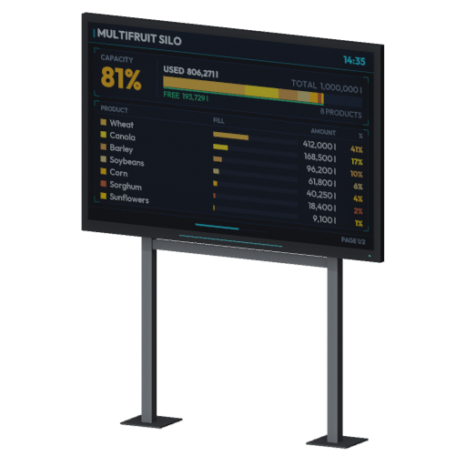
</p>

<p align="center">
  
  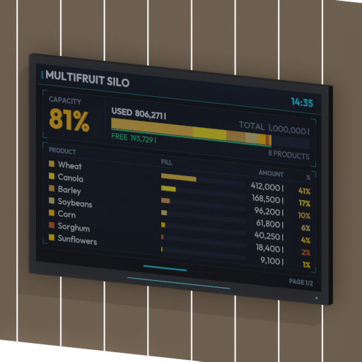
  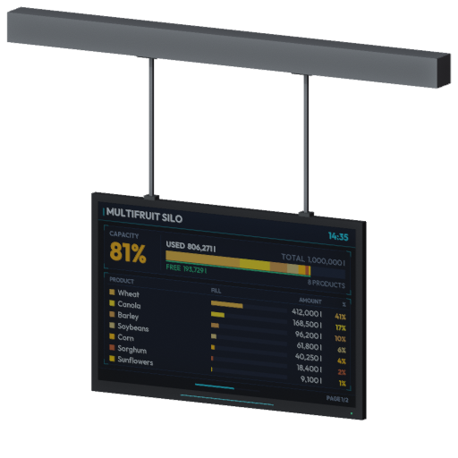
</p>

<p align="center">
  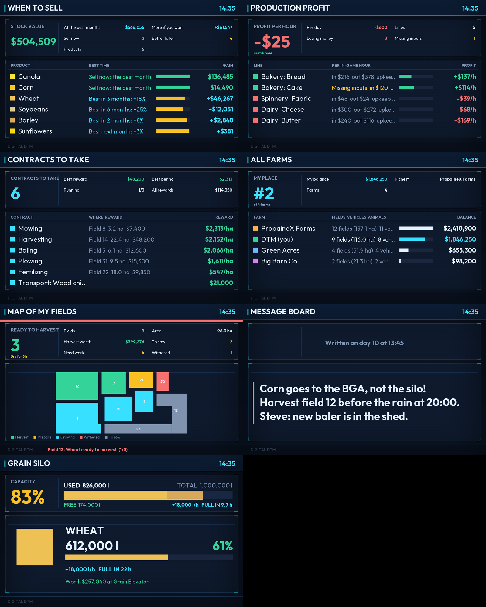
</p>

<p align="center">
  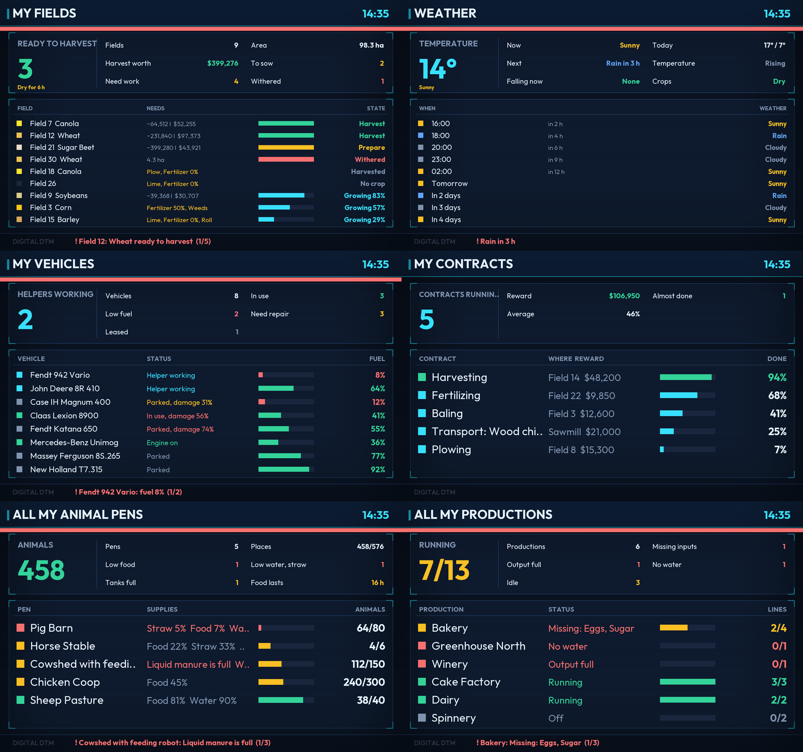
</p>

<p align="center">
  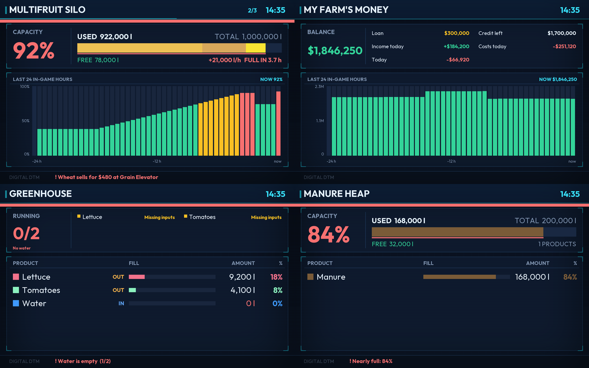
</p>

<p align="center">
  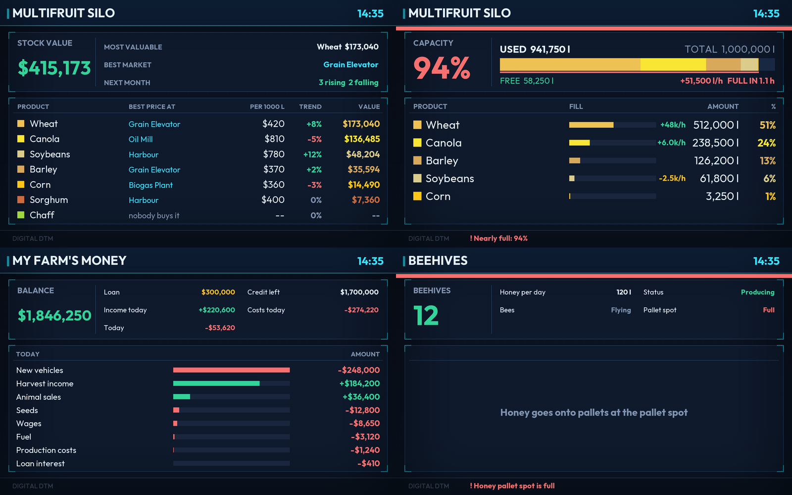
</p>

<p align="center">
  
</p>

<p align="center">
  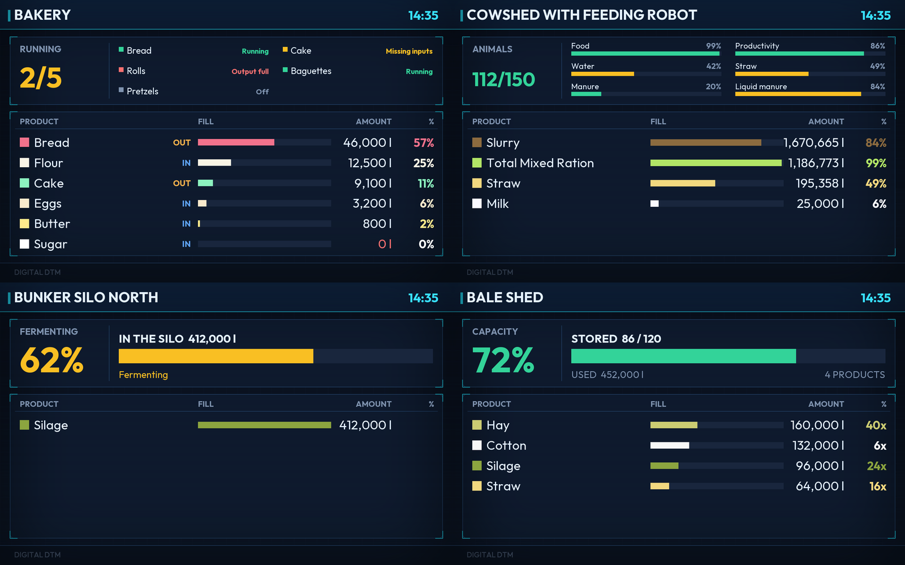
</p>

<p align="center">
  
</p>

<!-- dtm-screenshots -->

<p align="center">
  
</p>

<p align="center">
  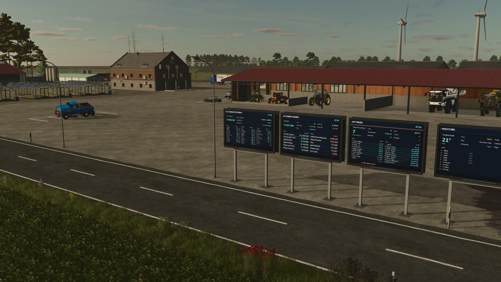
</p>

<p align="center">
  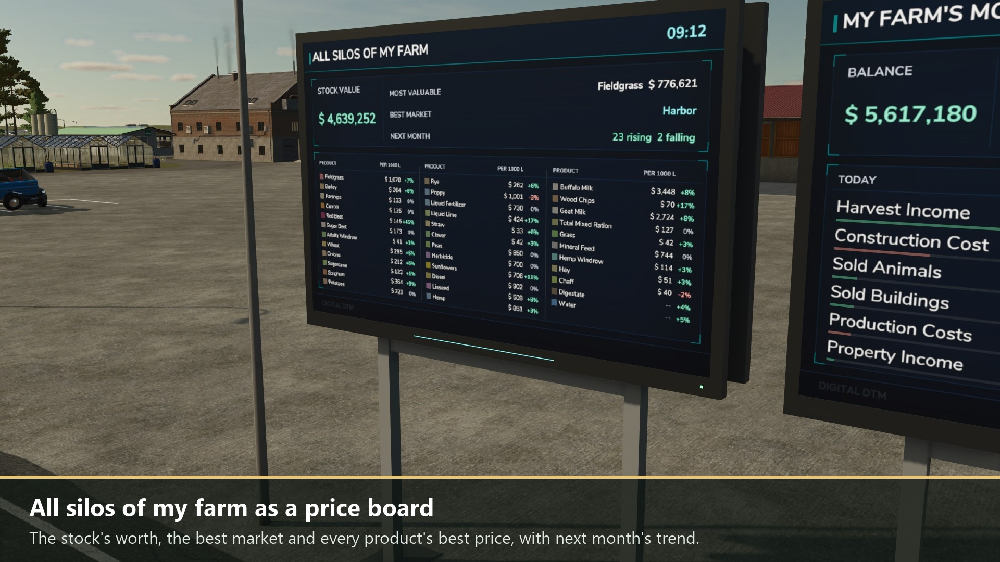
  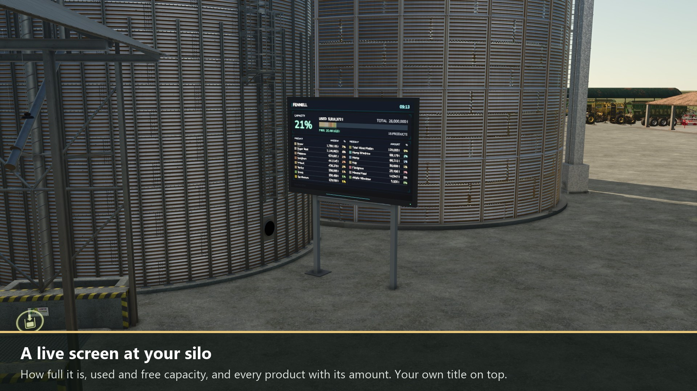
</p>

<p align="center">
  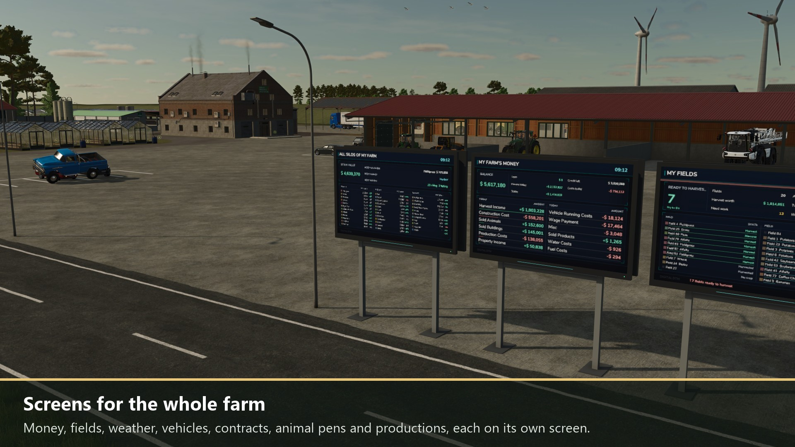
  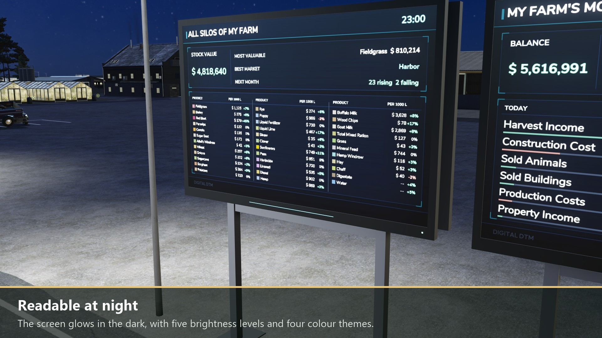
</p>

<!-- /dtm-screenshots -->

<p align="center">
  
</p>

1. Buy a monitor (Buildings > Tools) and place it at the storage you want to watch. Silo mounts go right against the
   silo wall: the back of the bracket touches it.
2. It shows the nearest storage within 40 m by itself, each building on its own: a silo, each silo extension, your
   farm's productions, animal pens, bunker silos, bale / pallet sheds, manure heaps and beehives. The screens of the
   whole farm are at the end of the pick list: all silos, money, fields, weather, vehicles, contracts, all pens, all
   productions.
3. Stand in front of the screen and press the activate key (**Monitor settings**):
   - **Pick the storage**: a list of every storage nearby, nearest first, or "Always the nearest". A picked silo stays
     picked when something nearer is built.
   - **Also show the silos connected to it**: a silo together with its extensions, as the game counts them when you
     load or unload.
   - **Screen size**: 0.8 to 6 m wide. The Silo Mount and Wall Mount keep their bottom edge 2 m above the ground
     (Hanging: 2.5 m) and grow upwards; the others grow from the ground, posts and all.
   - **Brightness**: very dim to very bright (screen glow, bars and text).
   - **Colours**: night blue, green, amber terminal, daylight.
   - **Title**: type your own, or leave it empty for the storage's name.
   - **Screen shows**: the storage, prices (the price board), or history (the last in-game day as a chart).
   - **Products shown**: all, or the ones you tick (up to 8); one alone is shown big.
   - **Write the message** (on a message board): `|` starts a new line, an empty text clears it.
   - **Alerts**: off, on the screen, or on the screen and as a game message for your farm.
   - **Nearly full from**: 70 to 100 % (default 90 %); red from there, amber from 15 below.
   - **Price alert**: pick a product and a price (5 to 50 % above today's best); a message when it sells for that.
   - **Slideshow**: tick the screens to show in turn (up to 8) and the time per screen (10, 20, 30 or 60 s). While it
     runs the header shows "2/3" and a thin bar for the time to the next screen.
4. More than 42 products: **Page Up / Page Down** in front of the screen (rebindable under Controls). The pages stay
   where you put them for 30 seconds. **Home / End** switch to the previous or next screen (in a slideshow, its
   previous or next screen).

<p align="center">
  
</p>

- The settings (storage, connected silos, size, brightness, colours, title, screen mode, alerts, nearly full level,
  price alert, slideshow) are synced: everyone on the server sees the same, and they are saved with the game. Paging is
  each player's own.
- A monitor shows the data of the farm that owns it, to everyone who looks at it: a player of another farm visiting
  your yard sees your fields, money, contracts and stock, not their own. Game messages from its alerts only go to
  the players of its own farm.
- The screen is drawn by each player's game. A dedicated server draws nothing, so it costs the server nothing.
- Alert messages go to the players of the monitor's own farm only, from each player's own game.
- Rates need about a quarter of an in-game hour of readings before they show. A monitor nobody is near still reads its
  storage every 10 seconds, so rates and alerts keep going.
- The server keeps the history of each monitor's picked (or nearest) storage, saves it with the game and sends it to
  every player, so the graph is there after a restart and for players who join. Screens in a slideshow that are not the
  picked one fill from the player's own readings.
- "All farms" shows another farm's balance only where the game shares it with your game; otherwise it shows "--".
- The fields and vehicles are read at most every 10 seconds for all monitors together.
- In 27 languages: every language the game has.

<p align="center">
  
</p>

Put `FS25_DigitalDTM.zip` in `Documents/My Games/FarmingSimulator2025/mods`. In multiplayer, install it on the server and
on every player's game.

<p align="center">
  
</p>

- The screen only shows while you look at its front and are within its reading distance (see the table above).
- No storage within 40 m: the screen says "No storage nearby".
- Every model has a collision for each screen size; the game switches on the one that fits, so a monitor can be
  selected (to sell it) at any size.

<p align="center">
  
</p>

How it works:

- **The screen:** the glass uses the game's `glowShader` (`staticLight`) with a baked panel texture per theme
  (`textures/screen_<theme>.dds`, swapped with `setMaterialDiffuseMapFromFile`); `lightControl` is the brightness.
  Text is drawn each frame with `renderText3D`. Bars are copies of a hidden 1 x 1 m glowing rectangle (`barTemplate`)
  placed, sized and coloured (`emitColor`) by the script; product icons are copies of `iconTemplate` with the fill type's
  HUD image as texture. The game does not draw `drawDebugTriangle` in normal play, and two bars at the same depth
  flicker, so bars never overlap.
- **The storage:** one entry per building (`spec_silo.storages`, `spec_siloExtension.storage`,
  `spec_husbandry.storage`, production storages, other mods' storages through their stations), the nearest within
  40 m or the picked one (remembered by the building's position). "Connected" adds every storage sharing a loading or
  unloading station. Silos with a shared capacity (`Storage.capacity`) count it once; other storages add up their
  per-product capacities.
- **The list:** `StorageMonitor.computeListLayout` picks 1 to 3 columns and the text size so everything fits.
  `python tools/render_screen.py` runs the real Lua and paints what it draws into `src/screens/`.
- **Settings:** the game's `OptionDialog`; `StorageMonitorSettingsEvent` syncs them; they are saved in the savegame.
- **Rates:** a sample of the levels every 5 in-game minutes, kept for 2 in-game hours; the rate is the change over
  that time. Animal food uses the pen's own `litersPerHour` when it has one.
- **Prices:** the unloading stations that sell (`isSellingPoint`, not the farm's own productions or animal pens),
  `getEffectiveFillTypePrice`, read at most every 10 seconds for all monitors; the trend is the fill type's
  `economy.factors` from this month to the next.
- **Farm screens ("boards"):** `buildBoard` reads the fields (`g_fieldManager`, the crop at each field's middle with
  `FSDensityMapUtil.getFruitTypeIndexAtWorldPos`, the ground from `field.fieldState`), the weather (`environment.weather`:
  `getCurrentWeatherType`, `getNextWeatherType`, temperatures), the vehicles (`vehicleSystem.vehicles`: fuel through
  `getConsumerFillUnitIndex`, `getDamageAmount`, `getIsAIActive`), the contracts (`g_missionManager:getMissionsByFarmId`)
  and the farm's pens and productions. Each gives rows (name, middle text, bar, value) drawn by `drawRowList`, a summary
  for the top panel and its problems for the alerts.
- **History:** a sample every half in-game hour, kept for 24 hours per screen (`updateGraph`), drawn as columns. The
  server samples each monitor's picked storage (`updateServer`), saves it in the savegame and sends new samples with
  `StorageMonitorGraphEvent`; joining players get it in the monitor's stream.
- **Field map:** the field borders (`field:getDensityMapPolygon():getVerticesList()`) are turned into a grid of cells once,
  runs of cells per field are the bars.
- **Performance:** a monitor out of sight reads its storage every 10 seconds (every 2.5 seconds beyond half its reading
  distance, every second up close); screens behind the camera are not drawn, and at most 8 monitors are drawn, nearest
  first. Fitted texts are measured once per reading, not every frame.

Everything is made from scripts:

```
python tools/make_textures.py                       screen texture (+ preview with sample data)
blender --background --factory-startup --python tools/build_model.py      models, i3d export, shop renders
python tools/make_icon.py                           mod icon (with the DTM pin) and modhub/icon_512.png
python tools/gen_placeables.py                      placeable XMLs from the i3d, shop images and icon to .dds
python tools/build_mod.py                           checks, tests, build/FS25_DigitalDTM.zip
```

Needs Blender 5.2 with the GIANTS I3D exporter, GIANTS Editor 10.0.14 (`textureTool.exe`), Python with Pillow and
[lupa](https://pypi.org/project/lupa/). `python tests/run_tests.py` runs the Lua offline on Lua 5.1 stubs of the engine.
The PNG masters in `src/` stay out of the zip (`.modignore`).

<p align="center">
  
</p>

### 1.4.0.3

- Meets the GIANTS ModHub checks (TestRunner): textures, icon and modDesc brought up to date.
- Errors are no longer hidden: they show in the log. A monitor that hits an error is switched off.

### 1.4.0.2

- Fixed: monitors could show the game's script error "setMaterial: Unknown entity id" while their lists changed (pages,
  farm screens). The game frees a material no shape uses, and the screens kept the ids of icon and colour materials to
  use again. They now make a new one each time an icon or theme changes and never keep one, as DashboardLive does.

### 1.4.0.1

- Fixed: a player of another farm looking at your monitors saw their own farm's fields, money, vehicles, contracts and
  stock. A monitor now always shows the farm that owns it.
- Fixed: after a monitor was removed, the others could show the game's script error "setMaterial: Unknown entity id"
  every frame (their product icons were made from the removed monitor). Each kind of monitor now makes its own icons
  and colour themes, and a removal makes them again.

### 1.4.0.0

- New screens: when to sell (best month per product on the seasonal prices), production profit (per line and in-game
  hour), contracts to take (best reward per hectare first), all farms (balance, fields, vehicles, animals), map of my
  fields, and a message board.
- My fields: the expected harvest and its worth, and the harvest window (how long it stays dry, a warning when fields are
  ready and rain is coming).
- Products shown: only the products you pick; one product alone is shown big.
- Home / End in front of a monitor switch to the previous or next screen.
- Fixed: Page Up / Page Down in front of a monitor did nothing (the keys were never registered).
- The history is kept by the server and saved with the game: there after a restart and for players who join.

### 1.3.0.0

- New screens for the whole farm: my fields (crop, growth, ready to harvest, what each field needs), weather (now, the
  next hours and days, crops dry or wet), my vehicles (helpers, fuel, damage), my contracts (where, reward, progress),
  all my animal pens and all my productions on one screen each.
- History: "Screen shows: History (24 h)" draws how full the storage was over the last in-game day (money: the balance).
- Slideshow: a monitor shows several screens in turn, 10 to 60 seconds each.
- Your own "nearly full" level per monitor (70 to 100 %), and a price alert for a product.
- New alerts: fields ready to harvest or withered, rain within 3 hours, a helper low on fuel, a vehicle badly damaged, a
  pen low on supplies, a production missing inputs.
- The pick list always shows the farm screens at its end, after the storages nearby.
- In every language of the game (27).

### 1.2.0.0

- Price board: the best price for every product and where to sell it, the trend to next month and the value of the
  stock (setting "Screen shows: Prices").
- Rates and time left: "+18,000 l/h", full / empty in, a rate per product, which production input runs out first, how
  long the animals' food lasts.
- Alerts on the screen (blinking stripe, footer line) and optionally as a game message for the farm.
- New kinds: manure heaps, greenhouses (no water flagged), beehives (all of the farm's hives on one screen), and the
  farm's money (balance, loan, credit, today's income and costs).
- Three new models: Two-Sided Billboard, Wall Mount (flat on a building) and Hanging (on rods, for inside a shed).
- Performance: far monitors read less often, nothing is drawn behind the camera, at most 8 monitors are drawn.

### 1.1.0.0

- Real product icons, four colour themes, five brightness levels, a glowing screen readable at night, your own title.
- Every model can be resized (0.8 to 6 m wide); a collision for every size, so monitors can be selected and sold at
  any size (the Silo Mount could not be selected before).
- New kinds of storage: productions (lines running, missing inputs, output full), animal pens (animals, food, water,
  straw, productivity), bunker silos (filling, fermenting, ready), bale and pallet sheds, and all silos of the farm.
- Shop picture of the Silo Mount on a silo wall.

### 1.0.0.1

- Fixed: productions and animal pens with a capacity per product (fermenting silos, cow barns) showed far over 100 %.

### 1.0.0.0

- First version: live storage screen in four models (Kiosk, Wall, Billboard, Silo Mount with a size setting), every product on one screen (up to 42, then pages with Page Up / Page Down), nearest storage within 40 m or a picked one, connected silos on request, adjustable screen size for the Silo Mount, settings synced in multiplayer and saved, English, German and French.

<p align="center">
  
</p>

MIT, see [LICENSE.txt](LICENSE.txt).

---

<p align="center">
  <a href="https://github.com/DTM-Mods"></a><br>
  <sub>Part of <a href="https://github.com/DTM-Mods">DTM Mods</a> (Designed To Manage) by PropaineX & Fennell</sub><br><br>
  <a href="https://ko-fi.com/dtmmods"></a>
  <a href="https://www.paypal.com/donate/?business=dtmmods%40gmail.com&amp;no_recurring=0&amp;item_name=DTM+Mods&amp;currency_code=USD"></a><br>
  <a href="https://www.youtube.com/@DTMMods"></a>
  <a href="https://dtmmods.itch.io"></a>
  <a href="https://www.kingmods.net/en/profile/dtmmods"></a>
</p>
