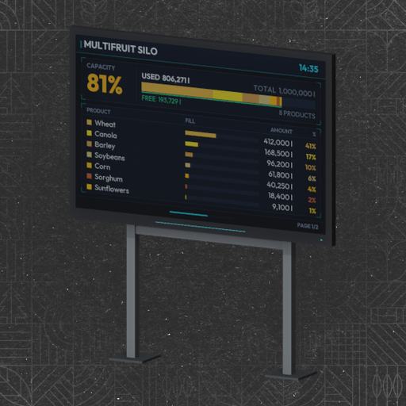

# ModHub upload: Better Digital Display

What to enter in the GIANTS ModHub upload form for this mod. Each text box below has a copy button on GitHub.



**Mod Icon (512x512):** [`icon_512.png`](icon_512.png)

| Field | Value |
|-------|-------|
| Title English | Better Digital Display |
| Title German | Better Digital Display |
| Title French | Better Digital Display |
| Version | `1` `0` `0` `0` |
| Author | DTM Mods, Fennell |
| Manufacturer | Lizard |
| Category 1 | Placeable > Miscellaneous |
| Category 2 | Not Set |
| Category 3 | Not Set |

## Title English
```text
Better Digital Display
```

## Title German
```text
Better Digital Display
```

## Title French
```text
Better Digital Display
```

## Description English
```text
Better Digital Display (Kiosk)
Category: Buildings > Tools
Price: $3,500
Monthly upkeep: $2

Better Digital Display (Wall)
Category: Buildings > Tools
Price: $6,500
Monthly upkeep: $3

Better Digital Display (Billboard)
Category: Buildings > Tools
Price: $12,000
Monthly upkeep: $5

Better Digital Display (Two-Sided Billboard)
Category: Buildings > Tools
Price: $18,000
Monthly upkeep: $7

Better Digital Display (Silo Mount)
Category: Buildings > Tools
Price: $6,000
Monthly upkeep: $3

Better Digital Display (Wall Mount)
Category: Buildings > Tools
Price: $5,500
Monthly upkeep: $3

Better Digital Display (Hanging)
Category: Buildings > Tools
Price: $5,500
Monthly upkeep: $3

A live screen for your silos, productions, animal pens, bunker silos, bale or pallet sheds, manure heaps, greenhouses and beehives, and for your whole farm: fields, weather, vehicles, contracts, money, a message board.

Place it at a storage and it shows what is in it, in colour:
- silos: how full in percent (green, amber, red from the level you set), used, free and total capacity, one bar with every product in its own colour
- how fast it fills or empties ("+18,000 l/h") and when it is full or empty
- productions: which lines run, which miss inputs or have a full output store; inputs (IN) and outputs (OUT), empty inputs in red; which input runs out first
- animal pens: number of animals, food, water, straw, productivity and the tanks; how long the food lasts
- bunker silos: filling, fermenting (in percent) or ready; several bunkers side by side
- bale and pallet sheds: how many of how many, and every product with its number of bales or pallets
- beehives: hives, honey per day and what it is worth, the pallet spot
- every product with its own icon, amount, fill bar and percent, all at once (up to 42, in up to 3 columns; more turn pages, also with Page Up / Page Down)
- or only the products you pick; one product alone is shown big, with its rate and what it is worth

Screens for the whole farm:
- my fields: the crop on every field, how far it has grown, which are ready to harvest (first), withered or to sow, what each needs (lime, fertilizer, plowing, rolling, weeds), the expected harvest and its worth, and how long it stays dry
- map of my fields: every field drawn in the colour of its crop's state
- weather: the temperature, the weather now, in the next hours and the next days, when it changes, and whether the crops are dry
- my vehicles: helpers at work, fuel and damage of every vehicle; low fuel and damage first
- my contracts, and contracts to take: the best reward per hectare first, and how many more your farm may take
- all my animal pens and all my productions on one screen each, the ones that need you first
- production profit: what every running production line earns per in-game hour, inputs, outputs and upkeep
- when to sell: for every product in your silos the best month on the seasonal prices and how much more it is worth then
- all farms: every farm on the server side by side, with money, fields, vehicles and animals
- message board: write a message everyone sees on the screen
- all silos of my farm, and my farm's money (balance, loan, credit, today's income and costs)

History: switch a screen to "History (24 h)" and it shows how full the storage was over the last in-game day as a column chart (the farm's money: the balance). The server keeps the history and saves it with the game, so it is there after a restart and for everyone who joins.

Price board: switch the screen to prices and it shows, for every product in the storage, the best price and where to sell it, whether the price rises or falls next month, and what the stock is worth.

Slideshow: tick several screens and the monitor shows them in turn (10 to 60 seconds each). In front of a monitor, Home / End switch to the previous or next screen.

Alerts: a blinking red stripe and a line in the footer when a silo is nearly full (from the level you set), an input is empty, animals run low on food or water, a tank is full, fields are ready to harvest (and rain is coming), a helper runs out of fuel, or a product sells for the price you wait for. Optionally also as a game message for everyone on the farm.

Stand in front of it and press the activate key for its settings: the storage or farm screen, connected silos, screen size (0.8 to 6 m wide), brightness (5 levels, readable at night), colours (night blue, green, amber terminal, daylight), your own title, storage, prices or history, the products shown, alerts, the nearly full level, a price alert and the slideshow. Everyone on the server sees the same settings and they are saved with the game.

Seven models (Buildings > Tools): Kiosk, Wall, Billboard, Two-Sided Billboard, Silo Mount, Wall Mount (flat on a building) and Hanging (on rods, for inside a shed).
```

## Description German
```text
Better Digital Display (Kiosk)
Kategorie: Gebäude > Werkzeuge
Preis: 3.500 €
Monatliche Unterhaltskosten: 2 €

Better Digital Display (Wand)
Kategorie: Gebäude > Werkzeuge
Preis: 6.500 €
Monatliche Unterhaltskosten: 3 €

Better Digital Display (Großanzeige)
Kategorie: Gebäude > Werkzeuge
Preis: 12.000 €
Monatliche Unterhaltskosten: 5 €

Better Digital Display (Großanzeige beidseitig)
Kategorie: Gebäude > Werkzeuge
Preis: 18.000 €
Monatliche Unterhaltskosten: 7 €

Better Digital Display (Silohalterung)
Kategorie: Gebäude > Werkzeuge
Preis: 6.000 €
Monatliche Unterhaltskosten: 3 €

Better Digital Display (Wandhalterung)
Kategorie: Gebäude > Werkzeuge
Preis: 5.500 €
Monatliche Unterhaltskosten: 3 €

Better Digital Display (Hängend)
Kategorie: Gebäude > Werkzeuge
Preis: 5.500 €
Monatliche Unterhaltskosten: 3 €

Ein Live-Bildschirm für Silos, Produktionen, Tierställe, Fahrsilos, Ballen- und Palettenlager, Misthaufen, Gewächshäuser und Bienenstöcke, und für den ganzen Hof: Felder, Wetter, Fahrzeuge, Aufträge, Geld, eine Nachrichtentafel.

An einem Lager aufgestellt, zeigt er dessen Inhalt in Farbe:
- Silos: Füllstand in Prozent (grün, gelb, rot ab dem eingestellten Füllstand), belegte, freie und gesamte Kapazität, ein Balken mit jedem Produkt in seiner eigenen Farbe
- wie schnell es sich füllt oder leert ("+18.000 l/h") und wann es voll oder leer ist
- Produktionen: welche Linien laufen, welchen Rohstoffe fehlen oder deren Lager voll ist; Rohstoffe (IN) und Erzeugnisse (OUT), fehlende Rohstoffe rot; welcher Rohstoff zuerst ausgeht
- Tierställe: Anzahl der Tiere, Futter, Wasser, Stroh, Produktivität und Tanks; wie lange das Futter reicht
- Fahrsilos: Befüllen, Gären (in Prozent) oder fertig; mehrere Silos nebeneinander
- Ballen- und Palettenlager: wie viele von wie vielen, und jedes Produkt mit seiner Anzahl Ballen oder Paletten
- Bienenstöcke: Anzahl, Honig pro Tag und sein Wert, der Palettenplatz
- jedes Produkt mit eigenem Symbol, Menge, Füllbalken und Prozent, alle auf einmal (bis zu 42, in bis zu 3 Spalten; mehr blättern, auch mit Bild auf / Bild ab)
- oder nur die Produkte, die du auswählst; ein einzelnes Produkt wird groß gezeigt, mit seiner Rate und seinem Wert

Bildschirme für den ganzen Hof:
- Meine Felder: die Frucht auf jedem Feld, wie weit sie gewachsen ist, welche erntereif (zuerst), verdorrt oder zu säen sind, was jedes braucht (Kalk, Dünger, Pflügen, Walzen, Unkraut), die erwartete Ernte und ihr Wert, und wie lange es trocken bleibt
- Karte meiner Felder: jedes Feld in der Farbe des Zustands seiner Frucht
- Wetter: die Temperatur, das Wetter jetzt, in den nächsten Stunden und den nächsten Tagen, wann es umschlägt, und ob die Früchte trocken sind
- Meine Fahrzeuge: Helfer im Einsatz, Kraftstoff und Schaden jedes Fahrzeugs; wenig Kraftstoff und Schäden zuerst
- Meine Aufträge und Offene Aufträge: die beste Belohnung pro Hektar zuerst, und wie viele Aufträge dein Hof noch annehmen darf
- alle meine Tierställe und alle meine Produktionen auf je einem Bildschirm, die zuerst, die dich brauchen
- Gewinn der Produktionen: was jede laufende Produktionslinie pro Spielstunde verdient, Rohstoffe, Erzeugnisse und Unterhalt
- Wann verkaufen: für jedes Produkt in deinen Silos der beste Monat nach den saisonalen Preisen und wie viel mehr es dann wert ist
- Alle Höfe: jeder Hof auf dem Server nebeneinander, mit Geld, Feldern, Fahrzeugen und Tieren
- Nachrichtentafel: eine Nachricht schreiben, die alle auf dem Bildschirm sehen
- alle Silos meines Hofes, und das Geld meines Hofes (Kontostand, Kredit, freier Kreditrahmen, Einnahmen und Ausgaben von heute)

Verlauf: auf "Verlauf (24 h)" umgestellt, zeigt ein Bildschirm als Säulendiagramm, wie voll das Lager über den letzten Spieltag war (beim Geld des Hofes: den Kontostand). Der Server führt den Verlauf und speichert ihn mit dem Spielstand, er ist also auch nach einem Neustart da und für jeden, der dazukommt.

Preistafel: auf Preise umgestellt, zeigt der Bildschirm für jedes Produkt im Lager den besten Preis und wo man es verkauft, ob der Preis nächsten Monat steigt oder fällt, und was der Bestand wert ist.

Diashow: mehrere Bildschirme ankreuzen, und der Monitor zeigt sie abwechselnd (je 10 bis 60 Sekunden). Vor einem Monitor schalten Pos1 / Ende zum vorherigen oder nächsten Bildschirm.

Warnungen: ein blinkender roter Streifen und eine Zeile unten, wenn ein Silo fast voll ist (ab dem eingestellten Füllstand), ein Rohstoff fehlt, den Tieren Futter oder Wasser ausgeht, ein Tank voll ist, Felder erntereif sind (und Regen kommt), einem Helfer der Kraftstoff ausgeht oder ein Produkt den Preis bringt, auf den du wartest. Auf Wunsch auch als Meldung im Spiel für alle Spieler des Hofes.

Vor dem Bildschirm öffnet die Aktivieren-Taste seine Einstellungen: das Lager oder der Hof-Bildschirm, verbundene Silos, Bildschirmgröße (0,8 bis 6 m breit), Helligkeit (5 Stufen, nachts lesbar), Farben (Nachtblau, Grün, Bernstein-Terminal, Tageslicht), ein eigener Titel, Lager, Preise oder Verlauf, die gezeigten Produkte, Warnungen, der Füllstand für "fast voll", eine Preiswarnung und die Diashow. Alle Spieler auf dem Server sehen dieselben Einstellungen, und sie werden mit dem Spielstand gespeichert.

Sieben Modelle (Gebäude > Werkzeuge): Kiosk, Wand, Großanzeige, Großanzeige beidseitig, Silohalterung, Wandhalterung (flach an einem Gebäude) und Hängend (an Stangen, für in der Halle).
```

## Description French
```text
Better Digital Display (Kiosque)
Catégorie : Bâtiments > Outils
Prix : 3 500 €
Entretien mensuel : 2 €

Better Digital Display (Mural)
Catégorie : Bâtiments > Outils
Prix : 6 500 €
Entretien mensuel : 3 €

Better Digital Display (Panneau)
Catégorie : Bâtiments > Outils
Prix : 12 000 €
Entretien mensuel : 5 €

Better Digital Display (Panneau double face)
Catégorie : Bâtiments > Outils
Prix : 18 000 €
Entretien mensuel : 7 €

Better Digital Display (Fixation silo)
Catégorie : Bâtiments > Outils
Prix : 6 000 €
Entretien mensuel : 3 €

Better Digital Display (Fixation murale)
Catégorie : Bâtiments > Outils
Prix : 5 500 €
Entretien mensuel : 3 €

Better Digital Display (Suspendu)
Catégorie : Bâtiments > Outils
Prix : 5 500 €
Entretien mensuel : 3 €

Un écran en direct pour vos silos, productions, élevages, silos couloirs, hangars à balles ou à palettes, fumières, serres et ruches, et pour toute votre ferme : champs, météo, véhicules, contrats, argent, un panneau de messages.

Placé près d'un stockage, il affiche son contenu, en couleur :
- silos : remplissage en pour cent (vert, orange, rouge à partir du niveau choisi), capacité utilisée, libre et totale, une barre avec chaque produit dans sa propre couleur
- la vitesse à laquelle il se remplit ou se vide (« +18 000 l/h ») et quand il sera plein ou vide
- productions : les lignes en marche, celles à qui il manque des intrants ou dont la sortie est pleine ; intrants (IN) et produits (OUT), intrants vides en rouge ; l'intrant qui manquera en premier
- élevages : nombre d'animaux, nourriture, eau, paille, productivité et réservoirs ; combien de temps dure la nourriture
- silos couloirs : remplissage, fermentation (en pour cent) ou prêt ; plusieurs couloirs côte à côte
- hangars à balles et à palettes : combien sur combien, et chaque produit avec son nombre de balles ou de palettes
- ruches : ruches, miel par jour et sa valeur, l'emplacement des palettes
- chaque produit avec son icône, sa quantité, une barre de remplissage et son pourcentage, tous en même temps (jusqu'à 42, sur 3 colonnes au plus ; au-delà les pages tournent, aussi avec Page préc. / Page suiv.)
- ou seulement les produits choisis ; un seul produit s'affiche en grand, avec son débit et sa valeur

Écrans pour toute la ferme :
- mes champs : la culture de chaque champ, son stade de croissance, ceux prêts à récolter (en premier), flétris ou à semer, ce dont chacun a besoin (chaux, engrais, labour, roulage, mauvaises herbes), la récolte attendue et sa valeur, et combien de temps le temps reste sec
- carte de mes champs : chaque champ dessiné dans la couleur de l'état de sa culture
- météo : la température, le temps actuel, dans les prochaines heures et les prochains jours, quand il change, et si les cultures sont sèches
- mes véhicules : ouvriers au travail, carburant et dégâts de chaque véhicule ; ceux qui manquent de carburant ou sont endommagés en premier
- mes contrats, et les contrats disponibles : la meilleure récompense par hectare en premier, et combien votre ferme peut encore en prendre
- tous mes élevages et toutes mes productions, chacun sur un écran, ceux qui ont besoin de vous en premier
- bénéfice des productions : ce que rapporte chaque ligne de production en marche par heure de jeu, intrants, produits et frais d'entretien
- quand vendre : pour chaque produit de vos silos, le meilleur mois selon les prix saisonniers et combien il vaut de plus à ce moment-là
- toutes les fermes : toutes les fermes du serveur côte à côte, avec argent, champs, véhicules et animaux
- panneau de messages : écrivez un message que tout le monde voit à l'écran
- tous les silos de ma ferme, et l'argent de ma ferme (solde, prêt, crédit, recettes et dépenses du jour)

Historique : passez un écran sur « Historique (24 h) » et il montre le remplissage du stockage pendant la dernière journée de jeu sous forme d'histogramme (pour l'argent de la ferme : le solde). Le serveur tient l'historique et le sauvegarde avec la partie : il est toujours là après un redémarrage et pour tous ceux qui rejoignent.

Tableau des prix : passez l'écran sur les prix et il montre, pour chaque produit du stockage, le meilleur prix et où le vendre, si le prix monte ou baisse le mois prochain, et la valeur du stock.

Diaporama : cochez plusieurs écrans et le moniteur les affiche à tour de rôle (de 10 à 60 secondes chacun). Devant un moniteur, Origine / Fin passent à l'écran précédent ou suivant.

Alertes : une bande rouge clignotante et une ligne en bas de l'écran quand un silo est presque plein (à partir du niveau choisi), qu'un intrant manque, que les animaux manquent de nourriture ou d'eau, qu'un réservoir est plein, que des champs sont prêts à récolter (et que la pluie arrive), qu'un ouvrier va tomber en panne de carburant ou qu'un produit se vend au prix que vous attendez. En option, aussi comme message du jeu pour tous les membres de la ferme.

Placez-vous devant et appuyez sur la touche d'activation pour ses réglages : l'écran de stockage ou de ferme, les silos reliés, la taille de l'écran (de 0,8 à 6 m de large), la luminosité (5 niveaux, lisible la nuit), les couleurs (bleu nuit, vert, terminal ambre, plein jour), votre propre titre, stockage, prix ou historique, les produits affichés, les alertes, le niveau « presque plein », une alerte de prix et le diaporama. Tous les joueurs du serveur voient les mêmes réglages, et ils sont sauvegardés avec la partie.

Sept modèles (Bâtiments > Outils) : Kiosque, Mural, Panneau, Panneau double face, Fixation silo, Fixation murale (à plat sur un bâtiment) et Suspendu (sur tiges, pour l'intérieur d'un hangar).
```

## Before uploading

- Screenshots: upload [`screenshots/`](screenshots/) (1600x900, unedited in-game shots, `1.jpg` first: no UI).
- The shop brand is NONE, so the manufacturer is Lizard like the other DTM script mods.
- In-game and dedicated-server testing still to be confirmed before an upload.
